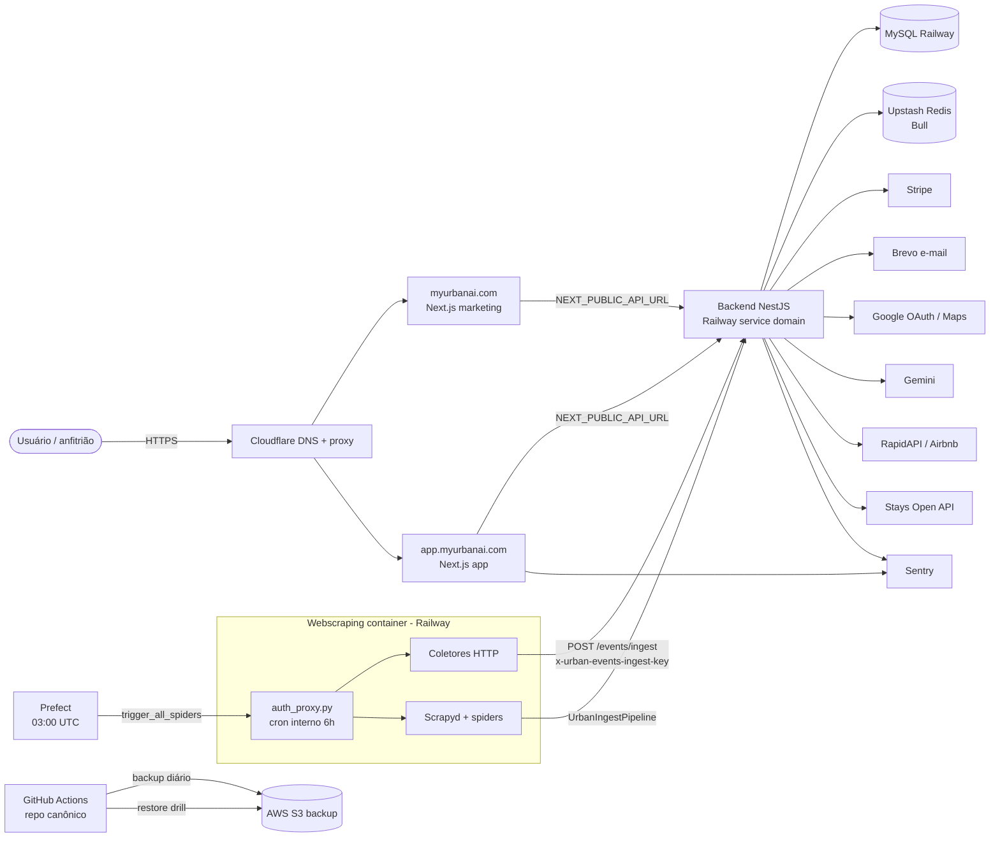

# Arquitetura atual — Urban AI

**Data:** 2026-10-23 · **Owner:** Engenharia (Gustavo) · **Status:** Canônico (estado atual de infraestrutura e integrações)
**Última validação:** 2026-10-23 (código + DNS + provedores) · **Próxima revisão:** após qualquer mudança de provedor, domínio ou deploy; no máximo 2026-11-30.
**Relação com outras fontes:** este documento é a fonte única do *estado atual* de topologia, ambientes, deploy e integrações. Detalhe interno de módulos, entidades e fluxos de negócio continua em [`product/ARCHITECTURE.md`](./product/ARCHITECTURE.md). Decisões e o porquê ficam nos [ADRs](./adr/README.md). Variáveis de ambiente: [`runbooks/matriz-env-operacional.md`](./runbooks/matriz-env-operacional.md). Acessos: [`ACESSOS-E-FERRAMENTAS.md`](./ACESSOS-E-FERRAMENTAS.md).

> Regra deste arquivo: nada de valores de secrets, senhas, IPs, URLs de banco ou detalhes exploráveis. Os repositórios são espelhados num remoto **público**.

---

## 1. Topologia

| Componente | Pasta | Stack (verificada no código) | Onde roda | Domínio / acesso |
|---|---|---|---|---|
| Frontend (marketing + app) | `Urban-front-main/` | Next.js 15 (App Router, output standalone), React 19, Tailwind 4, NextAuth 4, Sentry, Stripe.js | Railway (Dockerfile) atrás do Cloudflare | `myurbanai.com` (marketing) e `app.myurbanai.com` (app); roteamento por host em `src/middleware.ts` |
| Backend (API) | `urban-ai-backend-main/` | NestJS 11, TypeORM 0.3 + mysql2, Bull v3 (`@nestjs/bull` + `bull`), Stripe SDK, Sentry, Passport JWT, Helmet, Throttler | Railway (Dockerfile, Node 20) | Domínio de serviço Railway (`urbanai-production-85fd.up.railway.app`). **Não existe `api.myurbanai.com` ainda** (pendência) |
| Banco | — | MySQL gerenciado | Railway | Somente rede/variáveis do Railway |
| Fila / cache | — | Redis (Upstash) usado pelo Bull (fila `processos`) | Upstash | `REDIS_*` no backend |
| Webscraping | `urban-webscraping-main/` | Python 3.12, Scrapy + Scrapyd + Playwright, coletores HTTP próprios, `auth_proxy.py` na frente do Scrapyd | Railway (Dockerfile) | Domínio de serviço Railway; protegido por `SCRAPYD_API_KEY` |
| Pipeline | `urban-pipeline-main/` | Python 3.12, Prefect 3 (`serve.py`), Pandas/SQLAlchemy/boto3 | Container próprio (Dockerfile → `serve.py`) conectado ao Prefect via `PREFECT_API_URL`/`PREFECT_API_KEY` | Prefect (workspace sob responsabilidade do responsável operacional) |
| KNN legado | `urban-ai-knn-main/` | Python | **Aposentado** ([ADR 0007](./adr/0007-aposentar-knn-microservice.md)); ainda compila, sem tráfego | — |
| Load tests | `load-tests/` | k6 | Local/CI manual | — |

Contagem de referência (2026-10-23, apenas para ordem de grandeza): backend com 36 controllers, 21 jobs `@Cron` e ~90 arquivos `*.spec.ts`. Não use esses números como meta; recalcule quando precisar.

## 2. Diagrama



## 3. Fluxo de eventos (caminho vivo)

1. **Agendamento** — dois gatilhos coexistem:
   - Prefect: deployment `urban_webscraping` (`trigger_all_spiders`) às **03:00 UTC**, que pede ao Scrapyd para rodar os spiders.
   - Cron interno do container de webscraping (`auth_proxy.py`): roda os coletores a cada `COLLECTOR_CRON_INTERVAL_SECONDS` (padrão 21600 s = **6 h**) e, por padrão, também ao subir (`RUN_COLLECTORS_ON_BOOT`). Com `RUN_LEGACY_SPIDERS=true`, o runner agregado também agenda os spiders no Scrapyd.
2. **Coleta** — coletores HTTP (`urban_webscrapping/collectors/`) e spiders Scrapy (`urban_webscrapping/spiders/`).
3. **Envio** — ambos usam `UrbanBackendClient` e fazem `POST /events/ingest` no backend com o header `x-urban-events-ingest-key`. O backend valida contra `EVENTS_INGEST_API_KEY` (guard `EventsIngestApiKeyGuard`); no webscraping o mesmo valor fica em `URBAN_EVENTS_INGEST_API_KEY`. Headers opcionais de auditoria: `x-urban-collector`, `x-urban-collector-version`, `x-urban-ingest-run-id`.
4. **Backend** — dedup por `dedupHash`, geocoding lazy (`pendingGeocode`), escopo de cobertura, enrichment e inteligência de eventos (detalhe em [`product/ARCHITECTURE.md`](./product/ARCHITECTURE.md) §6).

**Problema conhecido (precisa de correção em código):** a `UrbanIngestPipeline` dos spiders Scrapy só é **habilitada** quando `URBAN_COLLECTOR_EMAIL` e `URBAN_COLLECTOR_PASSWORD` estão preenchidas (`urban_webscrapping/pipelines.py`), embora o envio use a API key quando ela existe e o backend só aceite a API key. Hoje, para os spiders enviarem eventos, é preciso `URBAN_EVENTS_INGEST_API_KEY` **e** as duas variáveis legadas não vazias. Os coletores HTTP funcionam só com a API key. Correção sugerida: habilitar a pipeline quando houver `URBAN_EVENTS_INGEST_API_KEY` e remover o caminho de login JWT legado.

**Fluxo S3 "bronze" do [ADR 0003](./adr/0003-prefect-cloud.md): inativo.** As pipelines S3 estão comentadas em `urban_webscrapping/settings.py`, e o bucket/prefixo que o webscraping gravaria não bate com o que o flow `raw_data_extraction_and_dump` (04:00 UTC) lê. Na prática esse flow não tem dados novos para carregar. Decisão pendente: reativar com bucket alinhado ou remover o flow.

## 4. Fluxo de requisição (host → front → API)

1. O navegador resolve `myurbanai.com` / `app.myurbanai.com` no Cloudflare, que faz proxy para o serviço de frontend no Railway.
2. O `middleware.ts` do Next.js separa marketing (apex) e app (`app.`); `www` e `.com.br` redirecionam (301) para o apex; rotas cruzadas redirecionam para o host correto.
3. O frontend chama a API em `NEXT_PUBLIC_API_URL`, que hoje aponta para o **domínio de serviço Railway** do backend (não há hostname canônico de API). As variáveis `NEXT_PUBLIC_*` são embutidas **no build** (Dockerfile `ARG`), então mudar a URL da API exige rebuild do front.
4. O backend autentica por JWT (Bearer ou cookie httpOnly), aplica CORS por whitelist (`CORS_ALLOWED_ORIGINS`) e rate limit global. Sem prefixo global de rota.
5. Health: `GET /health/live` (liveness, público) e `GET /health` (detalhado; exige `HEALTH_READINESS_TOKEN` fora de dev). Swagger em `/api` (desligado em produção, salvo `ENABLE_SWAGGER=true`).

## 5. Integrações

| Provedor | Uso | Quem chama | Variáveis (nomes) |
|---|---|---|---|
| Stripe | Checkout, assinatura, portal, webhook `POST /payments/webhook` | Backend; Stripe.js no front | `STRIPE_*`, `*_PRICE_*`, `*_PLAN`, `SUCCESS_URL`, `CANCEL_URL`, `NEXT_PUBLIC_STRIPE_PUBLISHABLE_KEY` |
| Stays | Conectar conta, sincronizar listings, preview/push/rollback de preço, auto-apply (fail-closed) | Backend | `STAYS_API_BASE_URL`, `STAYS_TOKEN_ENCRYPTION_KEY`, `STAYS_AUTO_APPLY_*` |
| Brevo | E-mail transacional | Backend | `BREVO_API_KEY`, `EMAIL_SENDER*`, `BREVO_API_BASE_URL` |
| Google OAuth | Login Google (front NextAuth + validação do idToken no backend) | Front + backend | `GOOGLE_CLIENT_ID`, `GOOGLE_CLIENT_SECRET`, `NEXTAUTH_SECRET` |
| Google Maps | Geocoding, distâncias | Backend | `GOOGLE_MAPS_API_KEY` |
| Gemini | Enrichment de eventos; extração LLM nos coletores Firecrawl/Tavily | Backend + webscraping | `GEMINI_API_KEY` |
| RapidAPI | Dados de anúncios Airbnb | Backend | `RAPIDAPI_KEY`, `AIRBNB_*` |
| Sentry | Erros/tracing | Backend + front | `SENTRY_DSN`, `NEXT_PUBLIC_SENTRY_DSN`, `SENTRY_AUTH_TOKEN` (build) |
| Upstash Redis | Fila Bull | Backend | `REDIS_HOST`, `REDIS_PORT`, `REDIS_PASSWORD`, `REDIS_TLS` |
| Prefect | Agendamento dos spiders | Pipeline | `PREFECT_API_URL`, `PREFECT_API_KEY`, Secret blocks |
| Scrapyd | Execução de spiders | Pipeline → webscraping | `SCRAPYD_URL`/`WEBSCRAPPING_API_URL`, `SCRAPYD_API_KEY` |
| APIs de eventos | Ticketmaster, API-Football, SerpAPI, Firecrawl, Tavily, SP Cultura | Webscraping | uma chave por coletor (ver matriz) |
| AWS S3 | Backup off-site do MySQL e restore drill (GitHub Actions); bronze legado (inativo) | GitHub Actions; webscraping/pipeline (legado) | `AWS_*`, `S3_BUCKET` (GitHub secrets) |
| Cloudflare | DNS autoritativo e proxy de `myurbanai.com` | — | Painel/API |
| Analytics | GA4 e Meta Pixel (opcionais) | Front | `NEXT_PUBLIC_GA4_ID`, `NEXT_PUBLIC_META_PIXEL_ID` |

## 6. Ambientes

| Ambiente | Frontend | Backend | Observações |
|---|---|---|---|
| Produção | `myurbanai.com`, `app.myurbanai.com` (Cloudflare → Railway) | Domínio de serviço Railway | Deploy automático pelo Railway a partir da `main` |
| Staging | Domínio de serviço Railway (`*-staging-staging.up.railway.app`) | Domínio de serviço Railway (`*-staging-staging.up.railway.app`) | `staging.myurbanai.com` **falha em TLS** hoje; use os domínios Railway. Em host `*.railway.app`, `COOKIE_DOMAIN=none` |
| Local | `localhost:3000` | `localhost:10000` (padrão local) | `.env` / `.env.local` fora do Git |

### DNS e e-mail do domínio

- Nameservers de `myurbanai.com`: **Cloudflare**. A antiga zona na Hostinger não é mais autoritativa (a Hostinger pode continuar sendo apenas o registrador; confirmar).
- Brevo: registros DKIM (`brevo1`/`brevo2`) e DMARC com `p=none` publicados.
- **Não há registro MX.** Endereços como `privacidade@` e `suporte@myurbanai.com` **não recebem e-mail hoje** — pendência.

## 7. Deploy

- **Frontend e backend:** Railway, build via Dockerfile de cada pasta, disparado pelo push na `main` (produção) e na branch de staging configurada no Railway.
- **Webscraping:** Railway, Dockerfile (Scrapyd + `auth_proxy.py`).
- **Pipeline:** container `serve.py` registrado no Prefect. Confirmar no Railway/Prefect se o serviço está ativo antes de depender dele.
- **Vercel:** o `vercel.json` da raiz **desliga deploys por Git** (os deploys são geridos fora do Git). O [ADR 0005](./adr/0005-hospedagem-railway.md) registra o Vercel como descartado para o produto. Estado honesto: **o produto roda no Railway**; não há deploy de produto via Vercel. Se alguma peça auxiliar vier a ser publicada via Vercel, registrar em um ADR.
- **CI (GitHub Actions, repo canônico):** `ci.yml` (gates de repositório, testes/build de backend e front, migrations em MySQL limpo, testes Python, smoke E2E condicional), `release-gate.yml`, `codeql.yml`, `backup-db.yml` (diário 03:00 UTC), `restore-drill.yml` (manual).

## 8. Repositório canônico

`urbanai-tech/urban.ai` é o repositório canônico e público: CI, CodeQL, `backup-db` e `restore-drill` rodam aqui. Toda mudança entra por Pull Request.

```bash
git fetch origin
npm run gate:repository            # secrets no HEAD, links de docs, DR, KNN legado
gitleaks git --no-banner           # ou "gitleaks detect": varredura antes de publicar
git push origin <branch>           # abrir PR contra a main
```

Nunca publicar sem rodar `npm run gate:repository` e o gitleaks. Qualquer arquivo com dado sensível deve ser tratado antes do push, porque o histórico público não se apaga com um commit novo.

## 9. Pendências conhecidas (genéricas)

| # | Pendência | Tipo |
|---|---|---|
| 1 | Há incidente de segurança P0 aberto; detalhes tratados fora deste repositório. | Segurança |
| 2 | Workflow de backup off-site está falhando por credenciais inválidas no provedor de armazenamento; restaurar credenciais e validar com um restore drill. | Operação / DR |
| 3 | Hostname canônico da API (`api.myurbanai.com`) não existe; front aponta para o domínio de serviço Railway. | Infra |
| 4 | `staging.myurbanai.com` falha em TLS. | Infra |
| 5 | Sem MX: caixas `privacidade@`/`suporte@` não recebem e-mail; DMARC ainda em `p=none`. | E-mail / LGPD |
| 6 | Pipeline de ingest dos spiders depende de variáveis legadas para ser habilitada (ver §3). | Código |
| 7 | Fluxo S3 bronze inativo e desalinhado (bucket/prefixo); decidir reativar ou remover. | Código / dados |
| 8 | `urban-pipeline-main/.env.example` ainda cita `PREFECT_SERVER_URL`; o código lê `PREFECT_API_URL`. `prefect.yaml` aponta para repositório/host antigos. | Código |
| 9 | Situação do Vercel sem ADR próprio (§7). | Decisão |
| 10 | Produção roda em `LAUNCH_MODE=prelaunch` (cadastro desviado para waitlist). Abertura depende do PR #22 + env explícita no Railway. | Produto |
| 11 | PRs em draft no repo da org: #22 (site comercial, modo `public`) e #19 (conector Stays com Basic auth/calendário, outbox de ingest, pipeline transacional). Ordem sugerida: #22 → rebase #19 → corrigir CodeQL/mypy do #19. | Código |
| 12 | Tabelas de preço divergentes entre site público, tabela `plans` do banco e matriz em `plans.service.ts`; definir fonte única. | Produto / cobrança |
| 13 | Lockfile do frontend fora de sincronia com `package.json` (`npm ci` falha); dependências com vulnerabilidades altas/críticas no front e no back (`npm audit`). | Código |
| 14 | `main` sem proteção de branch; secret scanning e alertas Dependabot desativados no repo da org. | Governança |
